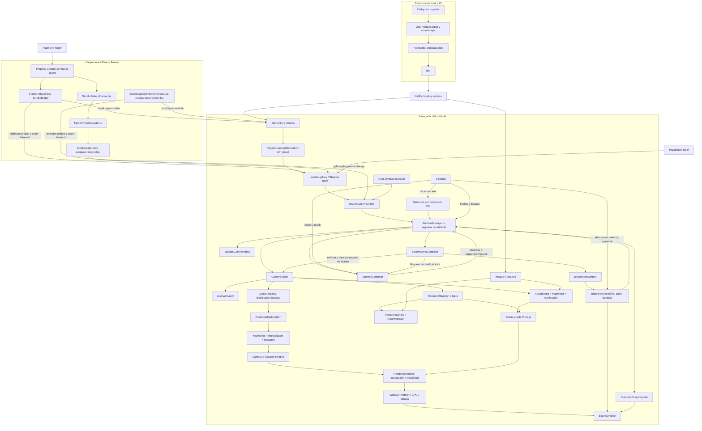
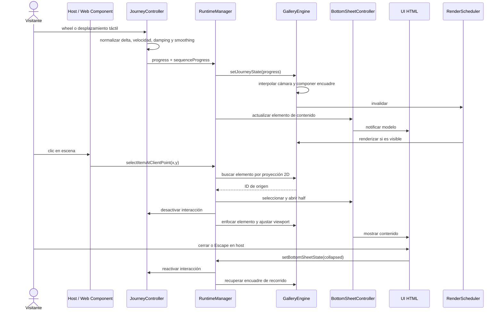
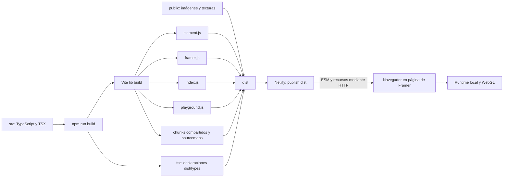
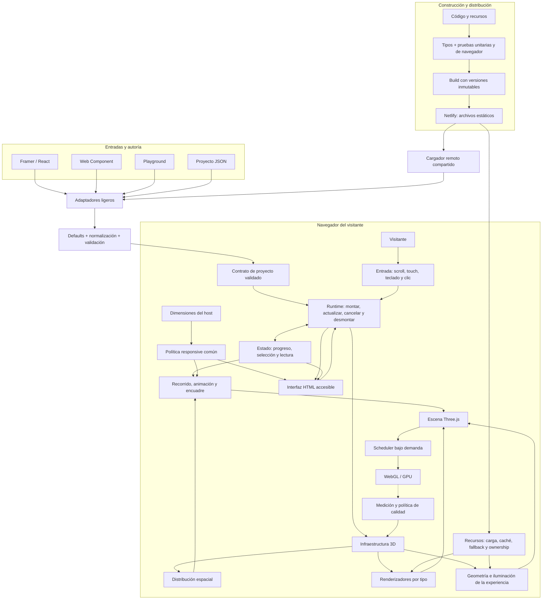

# Architecture Review — Scrollix 3D Corridor y evolución hacia Blueprint

Documento consolidado el 29 de octubre de 2026. Reúne la revisión técnica realizada el día anterior, la investigación posterior del historial Git y la arquitectura propuesta. Es documentación de análisis; no implica que las mejoras estén implementadas.

**Actualización de alcance:** tras la primera revisión se consiguió acceso de lectura a Git. La rama revisada contenía 25 commits y su estado de trabajo estaba limpio. La sección 17 incorpora esa evidencia y sustituye la limitación inicial respecto a Git. La versión desplegada en Netlify y el comportamiento visual real en Framer siguen sin verificarse.

Revisión del 28 de octubre de 2026. Repositorio: `C:\WORKSPACE\showcase\gallery-3d-v2`.

## Alcance y evidencia

Análisis estático de la estructura, contratos TypeScript, motor, navegación, renderizadores, recursos, interfaces DOM, componentes de Framer, playground y configuración de distribución. Se han ejecutado TypeScript sin emisión y las pruebas existentes: **16 archivos y 74 pruebas pasan**. No se ha modificado el repositorio. El caché de pruebas se ha dirigido a la carpeta de trabajo de este chat.

No se ha ejecutado una prueba visual en navegador ni una sesión real del editor de Framer. La restricción inicial de acceso a Git se resolvió después y sus conclusiones figuran en la sección 17. La URL de Netlify aparece en los puentes remotos; el intento de abrir su JavaScript con la herramienta web no permitió recuperar el recurso. Por tanto, este informe explica la configuración local y el contrato de despliegue, sin afirmar que la versión actualmente publicada coincida con este código.

## 1. Qué es el proyecto

Es un motor de experiencias narrativas 3D configuradas mediante un objeto JSON, `GalleryProject`. Una secuencia de elementos —imágenes, obras, textos, citas, perfiles o llamadas a la acción— se coloca en un espacio arquitectónico. El visitante avanza con rueda, trackpad, gestos táctiles o navegación discreta. La cámara recorre posiciones calculadas y el contenido seleccionado se presenta además en HTML.

Hay tres niveles distintos:

1. **Autoría:** controles de Framer, JSON o playground producen un proyecto.
2. **Ejecución:** un runtime independiente de React coordina estado, entrada, escena y contenido.
3. **Distribución:** Vite genera módulos y Netlify sirve JavaScript, imágenes y texturas.

El runtime descargado de Netlify **se ejecuta en el navegador del visitante**. El repositorio no configura un servidor de renderizado 3D, una API de contenidos, base de datos ni funciones de Netlify. La GPU local dibuja la escena con Three.js/WebGL.

## 2. Arquitectura completa

Las conexiones de recursos representan descargas HTTP. Las conexiones entre módulos del cliente son llamadas y suscripciones en memoria. No hay un viaje al servidor por cada movimiento de cámara.

## 3. Contrato de datos

`GalleryProject` contiene cuatro bloques:

| Bloque | Qué describe | Quién lo consume |
|---|---|---|
| `theme` | Calidad, atmósfera declarada, familia de textura, repetición, colores de luz y bordes | Validación, motor, materiales y renderizadores |
| `layout` | Tipo de espacio, separación y dimensiones | Estrategia de colocación y arquitectura |
| `journey` | Scroll/manual, loop, suavizado, inercia, sensibilidad, cámara y encuadre | Runtime, controlador y cálculo de cámara |
| `items` | Elementos ordenados y su contenido | Layout, renderizadores, selección y paneles |

Cada `GalleryItem` tiene `id`, `type`, `placement`, `appearance` y `content`. El layout añade `index`, `position`, `rotation`, `focusTarget` y `bounds`, creando un `PositionedGalleryItem`. El contenido admite campos arbitrarios, pero la proyección y los renderizadores solo interpretan los campos que conocen.

`validateGalleryProject` no es únicamente una comprobación: reconstruye el objeto, introduce valores por defecto, normaliza enumeraciones, limita muchos números y descarta campos no contemplados. Rechaza elementos sin ID/tipo e IDs duplicados. Permite nombres de layout y tipo extensibles; si no están registrados, el error se produce después al resolver el registro.

Los presets de overlay se convierten en distancias y desplazamientos. Los valores internos de encuadre derivados del preset se vuelven a calcular al validar; no son parámetros arbitrarios preservados del JSON.

## 4. Capa Framer: las rutas reales

| Archivo | Responsabilidad real | Relación con Netlify |
|---|---|---|
| `FramerAdapter.tsx` | Componente React por defecto `ScrollixBridge`, controles de contenido/estilo, generación de IDs, construcción de proyecto o lectura de JSON, loader e inserción del Web Component | Descarga `element.js?v=21` del dominio codificado y fija ese dominio como base de recursos |
| `ScrollixGalleryFramerRemote.tsx` | Otro `ScrollixBridge`, con un único proyecto fijo de demostración y loader; comprueba la conexión remota | También descarga el mismo `element.js?v=21` |
| `ScrollixGalleryFramer.tsx` | Componente React completo exportado por la entrada `framer`; crea Shadow DOM, monta el adaptador, adjunta paneles, progreso e interacción | Importa módulos locales del paquete; no descarga el runtime por URL por sí mismo |
| `framerProjectAdapter.ts` | Funciones puras para normalizar propiedades, construir elementos/proyecto y proporcionar defaults | Independiente de la red |
| `ScrollixGallery.tsx` | API imperativa `mountScrollixGallery`, normalización JSON/objeto, override de calidad, estado inicial, update y dispose | Pasa `assetBaseUrl` al runtime |
| `ScrollixLoader.tsx` | Presentación React de la carga con animaciones CSS | No descarga nada; los puentes remotos tienen copias internas de este loader |
| `framerOptionalModules.d.ts` | Declaraciones para los módulos opcionales React/Framer en la compilación local | Solo afecta al tipado |

### Ruta remota

`FramerAdapter.tsx` importa React y Framer, pero no el motor local. Inserta un `<script type="module">`, espera `load` y busca los tags `scrollix-gallery-v2` o `scrollix-gallery`. También intenta las funciones globales de registro y espera hasta aproximadamente ocho segundos si aún no aparece un tag.

Cuando está listo, crea un elemento, asigna `project` como JSON y `asset-base-url`, y lo coloca con `replaceChildren`. Al cambiar el JSON, vuelve a crear el elemento: se desmonta la instancia anterior y se monta otra. Esta ruta no llama al adaptador imperativo `ScrollixGallery.tsx` ni a `framerProjectAdapter.ts`; mantiene su propia construcción de proyecto y sus propios controles.

El puente con controles expone seis tipos: statement, artwork, quote, profile, image y CTA. Permite CTA con etiqueta y URL. El puente de prueba remoto contiene únicamente una introducción fija; no debe confundirse con el componente de autoría completo.

### Ruta integrada

`ScrollixGalleryFramer.tsx` recibe propiedades, combina defaults y llama a `buildScrollixGalleryFramerProject`. Admite siete tipos, incluido `video`, y una superficie más amplia: dimensiones, calidad, texturas, iluminación, cámara, navegación, encuadre, progreso inicial, panel y UI.

El constructor parte del proyecto de muestra o de JSON. Incluso usando JSON, las propiedades del componente sobrescriben diversos campos del proyecto: calidad, materiales, dimensiones, cámara y navegación. No equivale a pasar el JSON intacto.

Las plantillas modifican el proyecto: `reduced` usa los tres primeros elementos; `default-high` establece separación cero y altura siete. La fuerza de scroll automática se ajusta según la relación entre elementos originales y visibles.

El componente crea un host con Shadow DOM, viewport y barra de progreso, monta el adaptador y adjunta vistas HTML. Sus efectos manejan actualización y desmontaje. El adaptador imperativo valida el proyecto, monta el runtime y aplica progreso/panel iniciales.

### Qué se exporta realmente

`vite.config.ts` define cuatro entradas: `index`, `element`, `framer` y `playground`. La entrada `framer` apunta a `ScrollixGalleryFramer.tsx`. Ni `FramerAdapter.tsx` ni `ScrollixGalleryFramerRemote.tsx` son entradas de Vite; están disponibles como código fuente para su uso en Framer, pero no son la implementación elegida para `dist/framer.js`.

React y Framer están externalizados por Rollup y son peer dependencies opcionales. El consumidor del bundle de Framer debe resolver esas dependencias. El bundle `element.js` es la ruta que necesitan los puentes basados en script.

## 5. Runtime y ciclo de vida

| Archivo | Qué hace |
|---|---|
| `mountGalleryRuntime.ts` | Entrada de montaje: crea un manager predeterminado y le pasa las opciones del host |
| `createDefaultRuntimeManager.ts` | Compone RuntimeManager con los registros de layouts y renderizadores por defecto |
| `RuntimeManager.ts` | Coordina proyecto validado, motor, controlador de recorrido, elemento seleccionado, progreso, panel y suscriptores |
| `BottomSheetController.ts` | Conserva estado collapsed/half/full y elemento activo; publica un modelo de contenido |
| `createBottomSheetView.ts` | Construye HTML móvil, miniatura, título, descripción, secciones, enlaces y CTA; conecta botones y suscripción |
| `createDesktopPanelView.ts` | Construye panel lateral con título, descripción, cierre y anterior/siguiente |

Durante `mount`, el manager valida el proyecto, construye el mapa de progreso, crea el motor y espera su inicialización. Después crea el controlador si el modo es scroll y no se ha desactivado el arranque automático.

`syncProgress` manda el progreso al motor, resuelve el elemento activo de la secuencia, actualiza la selección, publica el contenido y notifica a los oyentes. Hay una distinción deliberada entre el elemento activo calculado por la cámara y el elemento activo secuencial utilizado por el contenido.

La API devuelta ofrece `updateProject`, `setProgress`, `focusItem`, `selectItem`, `selectItemAtClientPoint`, `nextItem`, `previousItem`, `setBottomSheetState`, lectura/suscripción de estado, lectura/suscripción de contenido y `dispose`.

`focusItem` mueve el progreso hacia el momento del elemento. `selectItem` abre el contenido y enfoca un elemento sin necesitar esa misma operación de avance. El panel abierto desactiva la interacción del controlador para que la lectura no desplace el recorrido.

`updateProject` reconstruye la escena, recrea el controlador y reinicia el progreso a cero. No hay actualización incremental por diferencias entre proyectos.

`whiteMix` sigue presente en contratos y callbacks, pero en el recorrido actual se fija a cero; no hay una transición blanca activa.

## 6. Interacción del visitante

La rueda se normaliza según deltas en píxeles, líneas o páginas. El controlador comprime deltas grandes, acumula velocidad, aplica amortiguación y acerca suavemente el progreso al objetivo. `ctrl+wheel` se deja pasar. El movimiento táctil sigue un identificador de contacto y aplica un multiplicador móvil.

Las flechas abajo/derecha avanzan; arriba/izquierda retroceden; Escape cierra el contenido. Estos eventos pertenecen al host, no al controlador de rueda/touch.

La selección mediante clic es una heurística en pantalla: proyecta centros y esquinas de elementos, comprueba profundidad y proximidad, y elige el candidato con mejor puntuación. No usa raycasting de las mallas ni comprueba la oclusión real de la escena.

El bottom sheet cambia de estado mediante botones: collapsed → half → full → collapsed. Hay cierre y doble clic para colapsar. El código actual no implementa un arrastre del panel con física de gestos.

Al abrir contenido, la cámara se coloca para encuadrar el elemento. En móvil se reserva aproximadamente el 52% de altura para el estado half y el 80% para full. En desktop se reserva una franja lateral calculada para el panel. Se actualizan aspect ratio, proyección y scissor/viewport del renderer.

## 7. Motor y recursos

| Archivo | Responsabilidad |
|---|---|
| `GalleryEngine.ts` | Inicializa Scene, PerspectiveCamera y WebGLRenderer; valida, resuelve calidad, construye escena, aplica cámara, selecciona por pantalla, ajusta viewport y libera recursos |
| `Registry.ts` | Registro genérico por tipo; evita duplicados y lanza error ante tipos ausentes |
| `RenderScheduler.ts` | Agrupa invalidaciones con requestAnimationFrame y evita dibujar cuando el documento o el contenedor están ocultos |
| `AssetManager.ts` | Selección de fuente de imagen, resolución de URL base, caché de promesas por URL y liberación de texturas |
| `ResourceLibrary.ts` | Comparte geometrías unitarias y materiales de superficies/brillos dentro de una construcción |
| `disposeObject3D.ts` | Recorre objetos y libera geometrías, materiales y texturas; deduplica geometrías/materiales por recorrido |
| `createArchitectureShell.ts` | Construye suelo, techo, paredes, rejillas, luminarias, LED, luces reales y efectos de iluminación |
| `createProceduralArchitecturalMaterials.ts` | Carga mapas de color/normal, genera fallback canvas y produce materiales con repetición ajustada a dimensiones/ciclos |
| `architecturalTextureFamilies.ts` | Reexporta el catálogo y dibuja texturas procedurales de piedra, madera y ladrillo |

El motor usa color de salida sRGB y ACES Filmic tone mapping. La cámara tiene plano cercano 0,1 y lejano 160. Hay niebla base y exposición por calidad. El color/niebla base actual es esencialmente fijo; declarar distintos nombres de atmósfera no implementa por sí mismo distintas escenas de luz.

La reconstrucción elimina la escena anterior, crea biblioteca de recursos y gestor de assets, coloca todos los elementos, genera keyframes, construye la arquitectura y crea en paralelo todos los objetos de contenido. Un contador `buildSerial` evita insertar al final una construcción que ya haya quedado obsoleta. Esa protección no cubre todos los puntos intermedios ni las instancias montadas fuera del motor.

El scheduler es bajo demanda. El controlador del recorrido tiene su propio requestAnimationFrame mientras existe movimiento pendiente; la escena se dibuja al invalidarse. Estar fuera de pantalla detiene el dibujo, pero no constituye una pausa global de toda la lógica del runtime.

## 8. Layouts y recorrido

| Archivo | Función |
|---|---|
| `CorridorLayout.ts` | Distribuye por índice/separación y lado de pared o estación; aplica offsets y alinea obras con módulos arquitectónicos |
| `InfiniteCorridorLayout.ts` | Reutiliza el layout de pasillo y crea tres ciclos físicos; los clones usan sufijo `__loop_N` |
| `GalleryRoomLayout.ts` | Distribución sencilla en filas de tres, con posiciones fijas y offsets |
| `layoutUtils.ts` | Vectores, bounds, escala, separación acumulada y profundidad de ciclo |
| `registerDefaultLayouts.ts` | Registra los tres layouts |
| `JourneyController.ts` | Entrada wheel/touch, inercia, smoothing, normalización de progreso y reinicio de loop |
| `cameraKeyframes.ts` | Genera inicio, aproximación/paso por estaciones, giro/foco/pausa ante paredes y final o empalme de loop |
| `getCameraStateAtProgress.ts` | Encuentra el tramo y aplica interpolación smoothstep a posición y lookAt |
| `framing.ts` | Calcula distancia de encuadre con FOV, relación de aspecto y dimensiones |
| `composeBottomSheetCamera.ts` | Sustituye el encuadre de recorrido por foco de lectura cuando el panel está abierto |
| `itemProgress.ts` | Mapa temporal por elemento, navegación adyacente, anticipación de elemento activo y umbral de reinicio |
| `loopProgress.ts` | Constante de progreso de reentrada del ciclo |

El loop no crea un espacio ilimitado: combina copias de contenido, continuidad de texturas/módulos, keyframe final desplazado y reinicio del progreso. El primer recorrido y los ciclos siguientes tienen un tratamiento distinto de la entrada para evitar repetir toda la aproximación inicial.

La configuración `auto` de lado se coloca en la pared izquierda en `CorridorLayout`; no hay alternancia automática izquierda/derecha en esa implementación. El layout de sala tampoco dispone de una arquitectura de sala específica: el motor sigue usando `createArchitectureShell`.

## 9. Renderizadores e iluminación

| Archivo | Resultado |
|---|---|
| `ArtworkRenderer.ts` | Imagen encuadrada según relación de aspecto, marco opcional y resplandor cálido |
| `ImageRenderer.ts` | Superficie de imagen con tratamiento visual más neutro y marco opcional |
| `VideoRenderer.ts` | Marco con textura obtenida por AssetManager e icono triangular de reproducción; no implementa vídeo reproducible |
| `StatementRenderer.ts` | Panel de texto oscuro con acento cálido |
| `QuoteRenderer.ts` | Panel de texto claro para citas |
| `ProfileRenderer.ts` | Panel de texto con paleta de perfil; no dibuja un retrato 3D a partir del campo image |
| `CtaRenderer.ts` | Panel de texto con tratamiento CTA; la navegación del enlace pertenece a la UI HTML |
| `createMediaFrame.ts` | Construcción común de plano de imagen, marco de barras y glow |
| `mediaAspectRatio.ts` | Lee dimensiones de imagen y ajusta el rectángulo sin deformarlo |
| `createTextPanel.ts` | Dibuja texto en canvas 1024×768 y lo convierte en textura; añade marco mural o portal de estación |
| `registerDefaultRenderers.ts` | Registra los siete tipos |
| `ArchitecturalBake.ts` | Crea degradados canvas y planos aditivos instanciados que simulan rebotes y halos LED; expone también una función de planificación |

Las luces visibles del techo y tiras LED son en gran medida geometría y materiales emisivos. Se combinan con AmbientLight, HemisphereLight, DirectionalLight y un RectAreaLight de relleno. El llamado bake es una simulación con planos y texturas generadas, no un proceso offline de iluminación global.

La arquitectura usa InstancedMesh para muchas piezas repetidas, reduciendo draw calls de rejillas, focos y halos. El contenido no está virtualizado: se construye entero, incluidos los tres ciclos del pasillo infinito.

## 10. Contenido HTML y estilos

`contentProjection.ts` transforma el contenido libre en un contrato común: título, descripción, metadatos, miniatura, secciones, enlaces sociales, acciones y CTA. Reconoce biografía, manifiesto, servicios, testimonios, referencias y contacto. Limpia cadenas vacías y valores literales `undefined`/`null`.

Los paneles construyen el contenido con `textContent`, evitando interpretarlo como HTML. Sin embargo, los destinos de enlaces se asignan directamente; no hay una política explícita de protocolos admitidos. Si el proyecto pasa a aceptar contenido no confiable, debe añadirse validación de URLs.

La UI móvil muestra más información que la desktop: secciones, enlaces y CTA existen en el bottom sheet, pero el panel lateral actual solo presenta eyebrow, título, descripción y navegación. No debe asumirse paridad funcional.

`scrollixGalleryStyles.ts` centraliza estilos del Web Component y del host Framer integrado: viewport, barra de progreso, indicación de swipe, sheet, panel, estados y simulación móvil. El Shadow DOM aísla la mayoría de los estilos de la página de Framer. Las reglas de viewport y los criterios móviles del motor no usan exactamente el mismo umbral, como se detalla en los hallazgos.

## 11. Calidad, catálogo y utilidades

| Módulo | Qué hace |
|---|---|
| `architecturalTextureCatalog.ts` | Catálogo tipado de familias, rutas color/normal y parámetros visuales; exporta opciones, valores y resolución de familia |
| `resolveQuality.ts` | Presets low/medium/high/ultra; límites de pixel ratio, detalle, sombras y presupuesto; elección auto por viewport/DPR/reduced-motion |
| `selectTextureSource.ts` | Filtra formatos compatibles y ordena por proximidad de calidad y preferencia de formato |
| `architecturalModules.ts` | Patrón modular, centros y ajuste de coordenadas para sincronizar arquitectura y contenido |
| `frameBudget.ts` | Promedio de tiempo por frame, umbral y sugerencia de bajar calidad; no constituye un regulador automático conectado al motor |
| `clamp.ts` | Límite numérico y normalización de números no finitos |
| `assertNever.ts` | Ayuda para ramas que deberían ser imposibles |
| `validateGalleryProject.ts` | Normaliza el proyecto completo y comprueba invariantes básicas |

Auto elige medium en móvil o reduced-motion; high para pantallas grandes o DPR alto; medium para el resto. No mide GPU ni FPS antes de elegir y no selecciona ultra automáticamente. Reduced-motion influye en calidad, pero no desactiva por sí mismo la inercia ni el movimiento de cámara.

La capacidad KTX2 está desactivada por defecto y no hay KTX2Loader en AssetManager. Que el contrato acepte ese formato no implica una ruta de decodificación operativa. Las texturas de arquitectura se cargan por una vía distinta de la selección de imágenes de elementos.

## 12. Playground, ejemplo y contratos públicos

`GalleryPlaygroundElement.ts` es un Web Component de herramientas de desarrollo. Presenta controles, sincroniza valores con el proyecto, aplica plantillas y emite `gallery-playground-change` con el proyecto resultante. No monta directamente el motor: el host escucha el evento y actualiza la galería.

`index.html` es la demo de desarrollo. Importa TypeScript directamente a través de Vite, crea `scrollix-gallery` y `gallery-playground`, asigna `premiumCorridorProject` y conecta los cambios. Al simular móvil activa atributos del host y una clase del body. El build configurado es de librería, por lo que no debe suponerse que esta página se publique como aplicación de producción.

`premiumCorridorProject.ts` proporciona contenido y parámetros de referencia reutilizados por demo y defaults del adaptador Framer integrado. No es una fuente remota ni una base de datos.

`src/index.ts` reúne exports públicos del motor, registros, recorridos, layouts, iluminación, runtime, adaptador imperativo, playground, muestra, tipos y utilidades. Exportar el playground desde la entrada general introduce evaluación de código dependiente del DOM; esa entrada no es neutral frente a SSR.

Los archivos de `types/` definen:

| Archivo | Contrato |
|---|---|
| `GalleryProject.ts` | Proyecto, tema, materiales y layout |
| `GalleryItem.ts` | Elementos, posición, apariencia, medios, acciones y proyección de contenido |
| `Journey.ts` | Configuración del recorrido, keyframes, cámara e interacción |
| `Layout.ts` | Estrategias y contexto de colocación |
| `Renderer.ts` | Factorías por tipo y recursos disponibles |
| `Runtime.ts` | Montaje, instancia y suscripciones |
| `ContentSurface.ts` | Modelo y controlador de contenido |
| `Quality.ts` | Presets, ajustes y perfil de dispositivo |
| `Assets.ts` | Fuentes de textura y capacidades de formato |

## 13. Build y Netlify

`package.json` define `build`, `dev:demo`, `typecheck`, `test` y `textures:sync`. Three.js es dependencia de ejecución. Vite, TypeScript y Vitest son dependencias de desarrollo.

`vite.config.ts` limpia dist, produce ESM, sourcemaps y entradas de nombre estable. Rollup puede separar código compartido en chunks que también deben publicarse. Copiar únicamente element.js no garantiza una instalación completa.

`tsconfig.json` activa strict, resolución Bundler y JSX preserve. `tsconfig.build.json` genera declaraciones y mapas de declaraciones; excluye tests de esa salida.

`netlify.toml` ejecuta `npm run build`, publica `dist` y fija Node 22. Configura CORS abierto y Cross-Origin-Resource-Policy para JavaScript, imágenes y texturas. JavaScript usa `max-age=0, must-revalidate`; imágenes/texturas usan un año e immutable.

Los puentes apuntan a `https://capable-youtiao-4bc2f1.netlify.app` y piden `/element.js?v=21`. El query es una elección de URL del puente, no una garantía de que exista un artefacto inmutable de versión 21: el archivo del despliegue sigue llamándose element.js.

Para actualizar recursos con caché immutable sin conservar contenido antiguo, se necesitan nombres/versiones nuevos o una estrategia explícita de invalidación. El repositorio no demuestra por sí solo cuál es la política operativa aplicada en producción.

`scripts/sync-texture-catalog.mjs` inspecciona carpetas de public/textures, identifica color y normal por nombres y agrega entradas al catálogo. No es una operación del navegador ni una subida a Netlify. Parte de `process.cwd()`, por lo que debe ejecutarse desde la raíz del repo. Las instrucciones de `.agents/TextureMappingAgent.md` son relevantes al añadir nuevas familias, pero esta revisión no añadió texturas.

## 14. Hallazgos y riesgos concretos

Son conclusiones de lectura del código. Las carreras y diferencias visuales que se indican requieren reproducción de navegador para medir su efecto real.

### Prioridad alta: ciclo de vida y errores de carga

1. **Montajes concurrentes en el Web Component.** `syncRuntime` comprueba `this.runtime` antes de un await y solo lo asigna al terminar el montaje. Una nueva actualización mientras se cargan assets puede iniciar otro montaje. Desconectar el elemento durante ese await puede dejar que la instancia termine después de `disconnectedCallback`, cuando `disposeRuntime` aún no tenía una referencia que liberar. Conviene una promesa de montaje única, generación de actualización y descarte/dispose de resultados tardíos.

2. **Carrera equivalente en el componente React integrado.** El contador de versión protege la sincronización final de vistas, pero el await de montaje puede completar después del cleanup y asignar un adaptador ya huérfano. Tampoco serializa actualizaciones simultáneas. Debe cancelarse lógicamente la operación y liberar su resultado si el efecto quedó obsoleto.

3. **Una imagen fallida puede abortar la construcción completa.** AssetManager propaga el rechazo de TextureLoader y el motor usa Promise.all para todos los objetos. La arquitectura sí tiene fallback de texturas, pero el contenido no tiene una política equivalente. Al no haber cleanup transaccional de todo lo construido parcialmente, un error deja también un riesgo de recursos sin liberar.

4. **Errores asíncronos sin estado visible consistente.** El Web Component y el componente integrado invocan operaciones con `void` y sin catch local. El loader remoto pasa a ready por registro del tag, antes de saber si el proyecto montó y cargó sus imágenes. Un script descargado correctamente no garantiza una galería operativa.

### Prioridad media: coherencia funcional

5. **Cambiar calidad no reconfigura todo el renderer.** updateProject recalcula ajustes y reconstruye escena, pero antialias se decide al crear WebGLRenderer; shadowMap.enabled y toneMappingExposure se asignan en init. El pixel ratio se aplica dentro de resize, que puede salir sin cambios si el tamaño/viewport no varía. Cambiar preset puede dejar una mezcla de ajustes antiguos y nuevos.

6. **Cambiar FOV en caliente no actualiza camera.fov.** La cámara se construye con el FOV inicial. Los keyframes y fórmulas de encuadre consultan el FOV del nuevo proyecto, pero updateProject no asigna ese valor a PerspectiveCamera. El resultado calculado y la proyección efectiva pueden diferir.

7. **Actualizaciones costosas y reinicio de navegación.** Toda modificación de proyecto reconstruye arquitectura y objetos y vuelve al inicio. La ruta remota incluso recrea el Web Component. Los controles input/change del playground pueden emitir cambios frecuentes; no hay debounce ni clasificación entre cambios de cámara, contenido, material y geometría.

8. **Propiedades de montaje ignoradas en update del adaptador imperativo.** `assetBaseUrl` y `autoStartJourney` se utilizan al montar, pero `ScrollixGalleryAdapter.update` solo actualiza proyecto/estado inicial. Cambiarlas en el componente Framer integrado no remonta ni reconfigura esas opciones. El Web Component sí contempla remount si cambian sus atributos equivalentes.

9. **Responsividad con criterios diferentes.** El motor usa ancho del contenedor ≤820; CSS cambia a desktop mediante media query del viewport ≥860; el perfil de calidad usa window.innerWidth. En un bloque estrecho dentro de una página ancha, o entre umbrales, pueden no coincidir panel, cámara y calidad. force-mobile ayuda a la demo pero no unifica estos criterios.

10. **Superficie Framer divergente.** El puente remoto ofrece CTA por controles y seis tipos; el integrado ofrece vídeo y más controles de escena, pero su construcción de items no incorpora CTA desde esos controles. Los catálogos de textura también difieren. No son dos implementaciones intercambiables de un contrato idéntico.

11. **Vídeo incompleto.** VideoRenderer dibuja un icono y usa TextureLoader; no hay VideoTexture ni reproducción. Un src de vídeo real no debe tratarse como una imagen. El tipo existe, la reproducción no.

12. **Atmósfera y otros campos con efecto limitado o sin consumidor.** La atmósfera se valida y expone, pero el motor restablece los mismos colores base. Campos como layout.seed/scale, placement.slot/anchor/priority y apariencia de iluminación/material/variant no equivalen necesariamente a funcionalidades activas: los layouts y renderizadores actuales consumen solo parte del contrato. El auto de pared se resuelve a izquierda.

13. **Selección y bounds aproximados.** La cámara y el clic usan bounds del layout; el renderer puede reducir el tamaño visible para respetar el aspecto de la imagen sin actualizar esos bounds. Puede haber márgenes seleccionables que no correspondan al cuadro visible. La selección tampoco contempla oclusión.

14. **UI desktop incompleta respecto al contenido.** El CTA, las secciones y enlaces que aparecen en móvil no están representados en el panel lateral actual. Esto afecta directamente a una galería usada como portfolio con acción comercial.

### Robustez y mantenimiento

15. **Carga remota sin cleanup/cancelación.** Los puentes insertan scripts por instancia, no los retiran ni cancelan callbacks/polling en su efecto. Hay loaders duplicados, dominio y query hardcoded y registro global de tags compartido. Se necesita un cargador compartido por URL, con estado/error y control de versión.

16. **Concurrencia parcial en GalleryEngine.** buildSerial comprueba la vigencia al final, pero durante rebuild se leen propiedades mutables como this.assets/this.project después de awaits. Una actualización puede reemplazar esos objetos mientras otra construcción sigue en marcha. Es preferible capturar un contexto inmutable por build y liberar de forma determinista los resultados obsoletos.

17. **Liberación de recursos a completar.** disposeObject3D y AssetManager pueden liberar las mismas texturas; el recorrido solo deduplica geometrías y materiales. Además, createProceduralArchitecturalMaterials crea materiales alternativos que createArchitectureShell no adjunta a ninguna malla, por lo que no los recoge el recorrido de la escena. La interfaz opcional ItemRenderer.dispose no es invocada por el motor. Conviene ownership explícito y un dispose por biblioteca/build.

18. **Contrato de extensibilidad con límites.** Separar IDs de origen mediante split('__loop_') reserva implícitamente esa cadena; un ID legítimo que la incluya puede resolverse mal. Definir múltiples tags con la misma clase de HTMLElement también requiere cuidado: la API permite tagName, pero no crea una subclase distinta para cada alias.

19. **Validación incompleta de entradas numéricas y URLs.** clamp protege muchos números, pero appearance.size numérico se acepta sin esa normalización. Los URLs de contenido no se restringen por protocolo. Debe endurecerse según la procedencia real de los proyectos.

20. **SSR y acceso al DOM.** El módulo del elemento crea un template a nivel superior; el playground accede a document/HTMLElement al importarse y se reexporta desde index. No debe asumirse que todas las entradas pueden importarse en Node/SSR sin entorno DOM.

21. **Presupuestos aún declarativos.** frameBudget ofrece cálculo pero no hay adaptación automática conectada. lightBudget influye en algunas decisiones, pero no es un contador estricto que limite todas las luces reales. El renderizado completo de todos los elementos y ciclos puede crecer de forma apreciable con proyectos largos.

22. **Textos largos y accesibilidad.** El canvas de texto es fijo y no tiene un ajuste global para evitar desbordamiento vertical. La representación 3D es bitmap; la UI HTML es la alternativa accesible, pero no hay una prueba integral de foco, lector de pantalla o reduced-motion del recorrido. El panel tiene botones de cambio de estado, no un gesto de arrastre implementado.

23. **Distribución de demo distinta de distribución de librería.** netlify publica dist y Vite está en lib mode. El index.html de desarrollo no demuestra una página de demo producida por ese build. Esto no impide usar element.js en Framer, pero hay que separar ambos objetivos de publicación.

24. **Tamaño de módulos.** La documentación plantea revisar archivos por encima de 300 líneas. Ya lo superan GalleryEngine (~716), playground (~952), estilos (~580), FramerAdapter (~581), componente Framer (~374), adaptador puro (~351) y validación (~346), además de módulos de arquitectura/materiales cercanos o superiores al límite. El mayor valor de dividir está en lifecycle, control schema, selección y viewport, no en fragmentar por número de líneas sin criterio.

## 15. Pruebas: qué está comprobado y qué falta

| Grupo de pruebas existente | Qué valida |
|---|---|
| validateGalleryProject | Normalización, defaults e invariantes del proyecto |
| framerAdapter | Construcción/normalización del adaptador y propiedades de proyecto |
| cameraJourney / composeBottomSheetCamera | Keyframes, continuidad y fórmulas de encuadre |
| journeyController | Progreso, entrada e interacción del controlador |
| itemProgress | Elemento activo, navegación y reinicio |
| corridorLayout / infiniteCorridorLayout | Colocación y copias de ciclo |
| contentProjection / bottomSheetController | Modelo de contenido y cambios de estado |
| registry / resourceLibrary | Registro y reutilización de recursos |
| architecturalModules / sampleProject | Patrón modular y proyecto de referencia |
| selectTextureSource / frameBudget | Elección de fuente y evaluación de presupuesto |

Resultado observado: **74/74 pruebas y TypeScript sin errores**. Las pruebas se ejecutan en entorno Node y se concentran en lógica y contratos. Ese resultado no comprueba montaje real WebGL, lifecycle de React en Framer, errores HTTP/CORS, imágenes remotas, viewport visual, fugas GPU ni compatibilidad del despliegue actual.

La siguiente validación técnica de mayor valor sería un conjunto pequeño de pruebas de navegador que cubra: desmontar durante carga; cambiar proyecto rápidamente; fallar una imagen; cambiar FOV/calidad sin redimensionar; abrir contenido en un host estrecho dentro de viewport desktop; y montar el puente contra un despliegue de prueba. Después tendría sentido medir memoria y draw calls con galerías largas.

## 16. Orden de mejora recomendado

1. Estabilizar montaje, actualización, desmontaje y error visible en Web Component y componente React.
2. Reconfigurar FOV/calidad de forma coherente y separar actualizaciones de escena de ajustes de cámara/UI.
3. Unificar el contrato de propiedades Framer y usar un cargador remoto compartido con versión configurable.
4. Unificar responsividad por dimensiones del host y completar CTA/contenido desktop.
5. Declarar explícitamente qué tipos/campos están operativos; implementar o retirar de controles lo que aún sea solo contrato.
6. Añadir pruebas de navegador para esas rutas, perfilar proyectos largos y después valorar virtualización o reciclaje de ciclos.

La separación entre configuración, colocación, renderizadores, runtime y adaptadores ofrece una base útil para estos cambios. La principal deuda está en el ciclo de vida asíncrono y la coherencia entre superficies públicas, más que en las funciones matemáticas ya cubiertas por tests.

## 17. Evidencia del historial Git

Investigación posterior a la revisión inicial, realizada en modo lectura. Se consultaron historial, cambios de archivos, estadísticas y estado de trabajo. No se crearon commits ni se modificó el repositorio.

| Commit | Fecha registrada | Evidencia relevante |
|---|---|---|
| `6013577` | 5 junio 2026 | El diseño inicial ya exige motor independiente, adaptadores ligeros, invalidación y revisión de archivos mayores de 300 líneas. El motor inicial tenía unas 264 líneas. |
| `c04bbb5` | 7 junio 2026 | Introduce ScrollixGalleryFramer, constructor puro de proyecto y pruebas. |
| `33936fd` | 7 junio 2026 | Añade la integración remota y amplía el Web Component sin sustituir la integración previa. |
| `539a178` | 7 junio 2026 | Simplifica el componente remoto: el diff contiene 130 inserciones y 546 eliminaciones. Hubo intentos de reducir complejidad. |
| `b11ac95` | 12 junio 2026 | Añade FramerAdapter.tsx con 502 líneas dentro de un commit cuyo título se centra en convertir imágenes a WebP. |
| `638d235` | 14 junio 2026 | Extrae ScrollixLoader como componente compartido y elimina sus implementaciones locales de ambos puentes. |
| `d78f3e2` | 14 junio 2026 | Reintroduce el loader local en los dos puentes: 70 inserciones y una eliminación en cada archivo; el componente compartido permanece. |

En la rama revisada había **25 commits**. `git status --porcelain` no devolvió cambios. `git ls-files` identificó **3.030 archivos dentro de node_modules y 118 dentro de dist**. El versionado de dependencias instaladas añade volumen y ruido de revisión; conviene decidir explícitamente si dist es un artefacto de distribución que deba permanecer versionado. No se propone reescribir el historial para corregirlo.

La extracción y posterior reintroducción del loader es una duplicación demostrable. No se conoce el motivo: una posible necesidad de archivos autocontenidos en Framer es solo una hipótesis. Si ese requisito existe, debe resolverse con generación de artefactos autocontenidos a partir de una única fuente.

Los commits aparecen bajo el usuario `goblinsami`. Git no identifica qué cambios generó Codex, qué prompts se utilizaron ni qué restricciones se discutieron fuera del repositorio. No se puede atribuir intención o responsabilidad individual a partir del nombre del autor.

**Conclusión respaldada por el historial:** el proyecto comenzó con una separación razonable y recibió refactorizaciones y pruebas, pero acumuló vías de integración y duplicaciones que no se consolidaron de forma sostenida. La arquitectura objetivo no requiere inventar todos los principios de nuevo: varios ya estaban documentados desde el primer commit.

## 18. Duplicaciones: cuáles consolidar y cuáles preservar

| Área | Duplicación | Acción propuesta |
|---|---|---|
| Loader visual | ScrollixLoader y copias dentro de ambos puentes | Una fuente compartida; generar una copia en el artefacto solo si el host exige autocontención. |
| Cargador remoto | Inserción de script, polling de tags, constantes URL y estados repetidos | Servicio compartido por URL/versión con promesa deduplicada, timeout y errores. |
| Construcción de proyecto | FramerAdapter y framerProjectAdapter mantienen normalizaciones separadas | Un constructor puro, con contrato y pruebas comunes. |
| Host | Teclado, clic, progreso, Shadow DOM y vistas repetidos en Web Component y React integrado | Extraer un controlador de host que ambos adaptadores utilicen. |
| Configuración | Defaults y mapeos similares en playground y Framer | Compartir esquema y transformaciones; conservar las vistas de controles propias de cada plataforma. |
| Renderizadores de imagen | Artwork e Image realizan carga y ajuste de aspecto similares | Compartir factoría parametrizada, manteniendo los tipos semánticos si son útiles. |
| Gestión de recursos | Dispose por recorrido y por AssetManager se solapan | Asignar un propietario único por recurso y una política explícita para recursos compartidos. |

Las rutas integrada y remota responden a modalidades de distribución distintas. No deben eliminarse por parecer similares sin confirmar cuál necesita el producto. Ambas pueden mantenerse como adaptadores pequeños sobre una implementación común.

## 19. Arquitectura objetivo

Es una propuesta de diseño para evolución incremental. No describe el estado actual ni exige construir un framework genérico antes de validar Blueprint.

| Pieza | Responsabilidad y utilidad |
|---|---|
| Adaptadores | Conectar cada host con el mismo runtime, sin implementar cámara o escena. |
| Configuración compartida | Evitar defaults y conversiones divergentes entre plataformas. |
| Contrato validado | Describir una experiencia reproducible y detectar entradas inválidas antes de construirla. |
| Runtime | Ser dueño del ciclo de vida, serializar cambios y liberar resultados asíncronos obsoletos. |
| Estado | Sincronizar progreso, selección y lectura con una fuente de verdad. Los objetos GPU permanecen fuera de este estado. |
| Entrada | Traducir eventos a intenciones, separando la captura de scroll de las reglas de navegación. |
| Infraestructura 3D | Gestionar renderer, escena, cámara y dependencias sin conocer el contenido específico de Corridor. |
| Experiencia | Definir geometría, distribución, estaciones, recorrido y animaciones propios de Corridor o Blueprint. |
| Responsive | Usar las dimensiones reales del host para coordinar interfaz y encuadre. |
| Interfaz | Mostrar contenido y acciones esenciales con paridad móvil/desktop y accesibilidad. |
| Recursos | Compartir cargas, aplicar fallback y liberar cada recurso cuando desaparece su último propietario. |
| Scheduler | Dibujar por cambios; mantener frames mientras una animación esté activa y detenerlos cuando termine. |
| Calidad | Aplicar ajustes coherentes y medir antes de introducir adaptación automática compleja. |
| Build y hosting | Publicar artefactos completos y versionados sin ligar el motor a un proveedor. |

### Reglas de dependencia

1. El núcleo no importa React ni Framer.
2. Los adaptadores no conocen objetos internos de Three.js.
3. La configuración fuente no se modifica durante la ejecución.
4. Cada operación asíncrona tiene un contexto estable y un mecanismo de invalidación.
5. Un cambio de cámara o interfaz no reconstruye toda la escena.
6. El desmontaje es idempotente y libera también las operaciones que terminan tarde.
7. Los recursos compartidos tienen ownership explícito; no se liberan desde dos capas independientes.
8. La configuración pública solo expone funcionalidades implementadas y verificables.

## 20. Qué reutilizar de Corridor para Blueprint

Blueprint, según el concepto discutido, es una landing inmersiva para estudios de arquitectura: recorrido horizontal sobre arquitectura conceptual, estructuras que se levantan según el progreso, estaciones narrativas y transición posterior al portfolio real. No requiere que el comprador aporte planos o modelos de sus edificios.

**El motor propiamente dicho** es la infraestructura que transforma configuración y entrada en una escena interactiva: renderer, escena, recursos, progreso, cámara y ciclo de vida. Está repartido por varios módulos; GalleryEngine es su centro actual, pero incorpora también decisiones específicas del corredor.

| Parte actual | Reutilización propuesta |
|---|---|
| RenderScheduler | Conservar invalidación y visibilidad; añadir una política explícita para animaciones activas. |
| JourneyController | Reutilizar normalización/smoothing donde encajen; separar progreso de la captura de eventos. Blueprint puede necesitar progreso derivado del scroll nativo de la página y una salida fluida hacia el portfolio. |
| AssetManager / ResourceLibrary | Reutilizar conceptos y partes de implementación tras corregir fallback, cancelación y ownership. |
| RuntimeManager | Conservar el patrón de coordinación; sustituir las reglas de selección/panel específicas y estabilizar lifecycle. |
| GalleryEngine | Extraer infraestructura WebGL, resize y renderizado; no copiar completa la clase con sus reglas de pasillo. |
| Interpolación y encuadre | Reutilizar matemáticas; crear keyframes y animaciones propios de Blueprint. |
| Validación y tipos | Reutilizar patrón de contrato; no forzar Blueprint a representar toda su narrativa como cuadros. |
| Framer | Elegir primero la modalidad de entrega y consolidar una integración con defaults comunes. |
| Netlify | Reutilizar publicación estática con artefactos completos y versiones fijadas. |
| Arquitectura del pasillo, loops y colocación mural | Mantener en Corridor; sustituirlos por geometría y recorrido específicos de Blueprint. |

No conviene comenzar creando un paquete universal de motores, escenas y plugins. Primero se desarrolla una sección vertical de Blueprint; la reutilización se extrae donde dos necesidades reales comparten un contrato estable.

## 21. Plan incremental de mejora

### Fase 1: estabilizar la infraestructura que se va a reutilizar

- Añadir generación de montaje/actualización y liberar resultados tardíos.
- Capturar proyecto, recursos y opciones por construcción, evitando lecturas mutables después de awaits.
- Incorporar fallback por asset y estados de error recuperables.
- Corregir actualizaciones de FOV, pixel ratio, exposición y sombras; definir qué cambios requieren recrear renderer.
- Verificar que montar/desmontar repetidamente no aumenta instancias, listeners o recursos retenidos.

### Fase 2: consolidar integración y contratos

- Unificar constructor de proyecto, defaults y loader remoto.
- Mantener una fuente de loader visual; generar archivos autocontenidos si hace falta.
- Separar cambios de host, configuración, cámara, materiales y geometría.
- Unificar responsividad por contenedor y completar acciones de contenido en desktop.
- Documentar campos operativos y retirar de controles lo que no tenga comportamiento implementado.

### Fase 3: implementar una sección vertical de Blueprint

- Un recorrido corto, una estructura animada y una estación narrativa.
- Entrada y salida mediante scroll compatibles con la página y el portfolio.
- Una integración Framer funcional y una alternativa de contenido accesible si WebGL falla.
- Validación visual móvil/desktop antes de ampliar escenarios o controles.

### Fase 4: distribución y mantenimiento

- Separar staging y producción; fijar una versión por consumidor.
- Publicar JS, chunks y assets como una unidad.
- Usar nombres con hash o rutas versionadas para recursos con caché immutable.
- Sacar node_modules del índice en un cambio dedicado, manteniendo lockfile; decidir la política de dist.
- Dividir módulos por responsabilidad y revisar cambios con títulos que reflejen su alcance real.

### Criterios de aceptación

| Área | Comprobación concreta |
|---|---|
| Lifecycle | Desmontar durante una carga no deja canvas, listeners ni instancias tardías. |
| Concurrencia | Cambios rápidos muestran el último proyecto y liberan las construcciones anteriores. |
| Assets | Una imagen fallida produce fallback o error localizado, sin bloquear toda la experiencia. |
| Cámara/calidad | Los cambios tienen efecto sin requerir redimensionar y mantienen coherencia de proyección. |
| Responsive | Un host estrecho dentro de viewport ancho usa panel y cámara compatibles. |
| Framer | Preview y página publicada cargan la misma versión prevista y desmontan correctamente. |
| Accesibilidad | Navegación de teclado, contenido HTML, foco y reduced-motion tienen comportamiento definido. |
| Rendimiento | Medir tiempos, memoria y draw calls en dispositivos y proyectos representativos antes de fijar presupuestos. |
| Distribución | Un despliegue nuevo no cambia silenciosamente el runtime de consumidores fijados a una versión anterior. |

## 22. Valoración y decisión de producto

La valoración discutida de **6/10** es orientativa, basada en lectura estática y pruebas unitarias. No es una medición objetiva ni una certificación de producción. Las fortalezas son separación modular, TypeScript y lógica probada; las debilidades prioritarias son lifecycle, coherencia entre integraciones y validación real en navegador.

La única venta comunicada por el usuario no permite deducir que la arquitectura sea la causa del rendimiento comercial. Una refactorización completa no garantiza demanda. La recomendación discutida es mantener Corridor con correcciones esenciales y avanzar hacia una versión pequeña de Blueprint, reutilizando infraestructura estabilizada sin convertir la perfección técnica de Corridor en un requisito previo.

## 23. Estado de este documento

- Hallazgos de código e historial: proceden de la revisión del 28 de octubre de 2026; no se han vuelto a ejecutar las comprobaciones al consolidar este archivo.
- Pruebas observadas en esa revisión: 16 archivos, 74 pruebas aprobadas y TypeScript sin errores.
- Riesgos de concurrencia y visuales: identificados por lectura; pendientes de reproducción e instrumentación en navegador.
- Arquitectura y fases propuestas: recomendaciones, sin implementación realizada.
- Despliegue actual de Netlify, configuración de cuenta y comportamiento real de Framer: no verificados.
- Repositorio original: no modificado por la elaboración de este informe.
